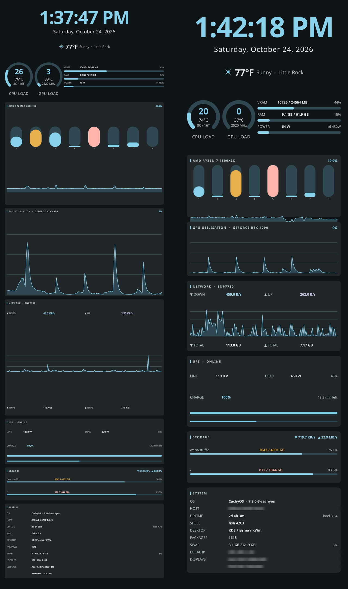

# casedash

A self-owned telemetry dashboard for a case-mounted portrait display — built to
replace Conky after it broke three times in four months.



<sub>Left: the original hand-tuned sizing. Right: the same layout with `Ui.qml`'s
`scale` raised to 1.55 — proportions preserved, text readable from a desk chair.</sub>

## The problem

I run a **HYTE Y70** case with a 1100×3840 screen in the front panel (DP-1,
rotated 90° CW). Conky drove it, and Conky kept dying:

| When | What broke | Root cause |
|---|---|---|
| ~2026-07 | Panel invisible after an Xwayland update | Xwayland stopped compositing X11 to the secondary output |
| 2026-10-13 | Crash loop (`status=6/ABRT`) | Conky 1.25.2 Wayland `pango_fonts.size()` assertion |
| 2026-10-22 | Black screen, unit reported **active** | A package update dropped `pacman.conf.pacnew`, erasing the `IgnorePkg = conky` pin → 1.25.2 reinstalled → Conky silently fell back to console output |

That last one is the reason this project exists. The panel was **pure black**
while `systemctl` said `active (running)` and the journal was full of healthy
telemetry. Service status is not evidence. Pixels are evidence.

The pattern is structural rather than bad luck. Conky fuses data collection with
its display backend, and it cannot choose which output to draw on
([upstream #2106](https://github.com/brndnmtthws/conky/issues/2106)). On a
non-standard vertical panel, every update is a dice roll.

## The fix

Split the data layer from the render layer:

```
  collector  ──►  $XDG_RUNTIME_DIR/casedash/state.json  ──►  renderer
  (Python,        (one atomic JSON blob,                 (Qt6/QML,
   stdlib only,    rewritten every 3s)                    layer-shell,
   systemd user                                           pinned by output name)
   service)
```

The renderer is now the **only** component coupled to the display stack. If a
Wayland or KWin update breaks it, it can be rewritten without touching a line of
telemetry code. Qt6's layer-shell integration is the same stack KDE itself uses,
and it can address an output *by name* — which is precisely what Conky cannot do.

## What it shows

Clock and date · weather · CPU load/temp/per-core bars · GPU util/temp/VRAM ·
RAM and swap · network rates plus history · UPS status · disk usage · system info.

Every value is polled from a local source (`/proc`, `/sys`, `nvidia-smi`,
`apcaccess`, `fastfetch`, `wttr.in`). Nothing is sent anywhere.

## Requirements

- **Qt 6** — Core, Gui, Qml, Quick, plus `moc`
- **layer-shell-qt** (the `LayerShellQtInterface` lib and headers)
- **Python 3** — standard library only, no pip installs
- Optional, for the full panel: `nvidia-smi`, `apcaccess` (apcupsd), `fastfetch`

## Install

```bash
git clone https://github.com/ngillmore/casedash.git
cd casedash

# 1. Build the renderer (plain g++ + pkg-config -- no cmake).
./renderer/build.sh

# 2. Install the Wayland socket resolver the renderer unit expects.
#    This exists because hardcoding WAYLAND_DISPLAY is how the old Conky died:
#    a stale socket sent it to console output while systemd reported "active".
install -Dm755 /dev/stdin ~/.local/bin/casedash-wayland-env.sh <<'EOF'
#!/usr/bin/env bash
set -uo pipefail
RUNTIME="${XDG_RUNTIME_DIR:-/run/user/$(id -u)}"
for s in "$RUNTIME"/wayland-*; do
    [ -S "$s" ] || continue
    case "$s" in *.lock) continue ;; esac
    export WAYLAND_DISPLAY="$(basename "$s")"
    break
done
[ -n "${WAYLAND_DISPLAY:-}" ] || { echo "no Wayland socket" >&2; exit 1; }
export QT_QPA_PLATFORM="${QT_QPA_PLATFORM:-wayland}"
# Mandatory: without this Qt picks xdg-shell, LayerShellQt refuses to attach,
# and the panel silently lands on your primary monitor instead.
export QT_WAYLAND_SHELL_INTEGRATION=layer-shell
exec "$HOME/projects/casedash/renderer/build/casedash" \
    -s "${CASEDASH_OUTPUT:-DP-1}" \
    -f "$RUNTIME/casedash/state.json" \
    -t "$HOME/projects/casedash/renderer/qml/Theme.qml" \
    "$HOME/projects/casedash/renderer/qml/main.qml"
EOF

# 3. Point the units at your clone (they ship with /home/yak paths).
sed -i "s|/home/yak|$HOME|g" systemd/*.service systemd/*.timer verify.sh
# ...and at your case screen's output name. Find it with: kscreen-doctor -o
sed -i "s|DP-1|YOUR-OUTPUT|g" ~/.local/bin/casedash-wayland-env.sh

# 4. Install and start.
cp systemd/*.service systemd/*.timer ~/.config/systemd/user/
systemctl --user daemon-reload
systemctl --user enable --now casedash-collector.service casedash.service
systemctl --user enable --now casedash-verify.timer
```

## Configuration

The collector reads these from the environment (set them in
`systemd/casedash-collector.service` under `[Service]`):

| Variable | Default | What it does |
|---|---|---|
| `CASEDASH_NET_IFACE` | `enp77s0` | Interface to graph. Find yours: `ip route get 1.1.1.1` |
| `CASEDASH_WX_LOCATION` | `auto` | [wttr.in](https://wttr.in) location slug. `auto` geolocates from your IP |
| `CASEDASH_THEME` | `~/projects/casedash/renderer/qml/Theme.qml` | Where the generated palette lives |

## Resizing the text

Every font size, padding and row pitch derives from **one number**: `scale` in
`renderer/qml/Ui.qml`.

```bash
# edit renderer/qml/Ui.qml -> readonly property real scale: 1.55
systemctl --user restart casedash.service
```

Why a scale factor instead of just bigger literals: the panel is 1100×3840 and
every size was hand-tuned against a real capture. Scaling from one number keeps
those tuned *proportions* intact — the design looks the same, only larger.

Two things worth knowing before you change it:

- **`Ui.qml` must be a QML singleton** (declared in `qmldir`), not a context
  property. A context property is **not visible inside imported component
  files** — `Card.qml` and `KeyValue.qml` silently evaluated every binding to
  `undefined`, producing a wrong layout with only a vague warning. This cost me
  a debugging cycle; don't repeat it.
- **Gauges use a separate, gentler `gaugeScale`.** Two gauges plus the
  VRAM/RAM/POWER value stack have to fit inside 1100px. At the full text scale
  the gauges starved the value column until `10726 / 24564 MB` elided. The gauges
  were never the readability problem, so they grow less and hand the width back.

Practical ceiling is about `scale: 1.7`; past that the STORAGE and SYSTEM value
columns start eliding.

## Verifying it actually works

```bash
./verify.sh
```

Never trust `systemctl is-active` alone. `verify.sh` asks **KWin** where the
`casedash` window is and asserts its geometry, its layer (0 = background), the
process, and the freshness of `state.json`. A `casedash-verify.timer` runs it
every 15 minutes.

## Repo layout

```
collector/casedash_collector.py   telemetry daemon -> state.json
renderer/src/host.cpp             Qt6 C++ QML host + LayerShellQt output pinning
renderer/qml/                     QML UI
renderer/qml/Ui.qml               layout + type metrics (the `scale` knob)
renderer/qml/Theme.qml            default palette (regenerated by matugen)
renderer/build.sh                 moc + g++ build, no cmake
systemd/                          user units
verify.sh                         pixel/geometry verification
theme/                            matugen -> Theme.qml bridge + RGB sync
archive/                          the retired Conky setup, for reference
```

## Gotchas

Hard-won, all of them:

- **`QT_WAYLAND_SHELL_INTEGRATION=layer-shell` is mandatory.** Without it Qt uses
  its default xdg-shell integration, LayerShellQt refuses to attach with
  *"already has a shell integration"*, and the panel silently lands on your
  primary monitor. This is the non-obvious failure mode when pinning "doesn't work".
- **`QWindow::setScreen()` is ignored before `show()`** on Qt's Wayland backend.
  Output pinning must go through `LayerShellQt::Window::setScreen()`, which sets
  it on the layer surface rather than the toplevel.
- **A QML root must be a `Window`** — `qmlscene`/`qml6` cannot create `Window`
  types, so a compiled C++ host is required.
- **The black-panel-with-active-unit signature is a Wayland socket-name mismatch.**
  The renderer unit deliberately does *not* hardcode `WAYLAND_DISPLAY`; the
  wrapper resolves the live socket every boot.
- **The collector stays off the game's resources:** `Nice=10`, `CPUWeight=15`,
  `MemoryMax=512M` on the renderer; `Nice=5`, `CPUWeight=20`, `MemoryMax=256M`
  on the collector. This box is primarily a gaming machine.
- Hardware-specific probes (core count, apcupsd UPS fields, interface name)
  degrade to `null` rather than failing, so the panel renders on other systems
  with those fields simply blank.

## License

MIT — see [LICENSE](LICENSE).
